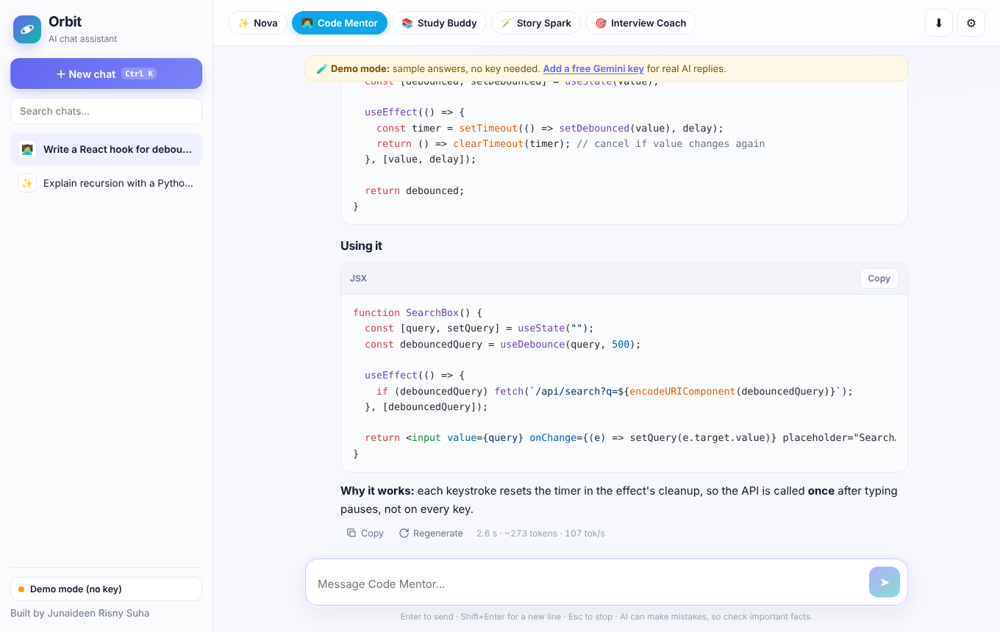
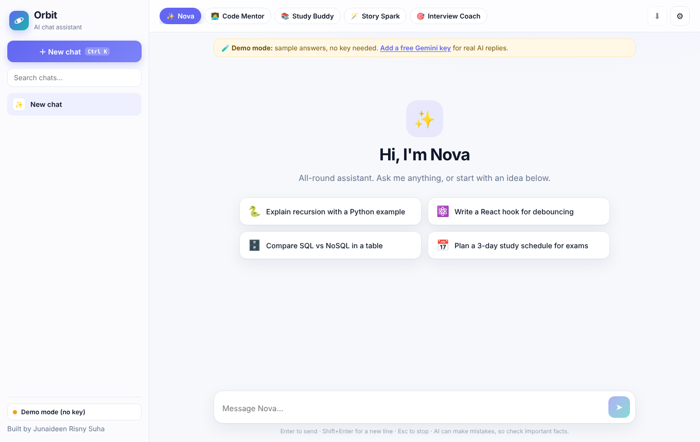
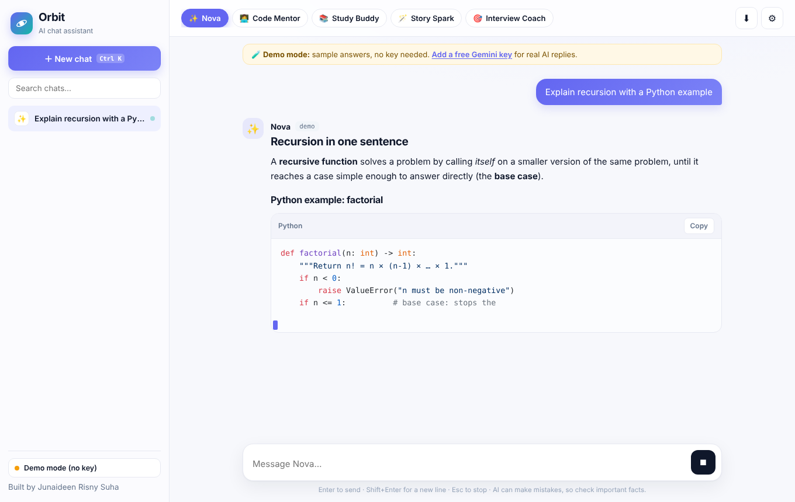
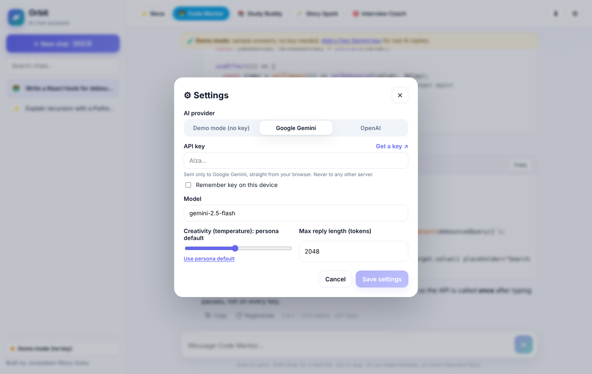
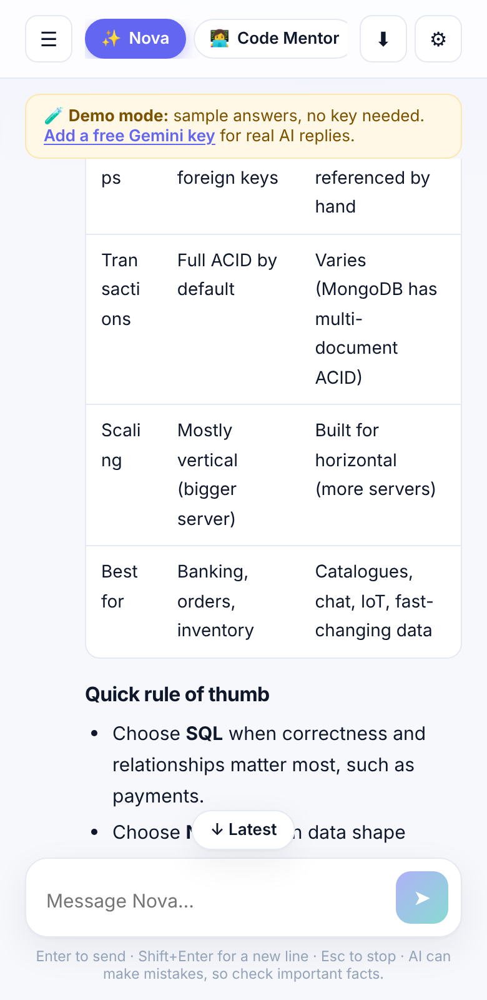

<div align="center">

# 🪐 Orbit: AI-Powered Advanced Chatbot

### A React chat app with live token streaming, 5 AI personas and syntax-highlighted code blocks

[](https://github.com/DevRisny/Orbit-AI-Chatbot/actions/workflows/ci.yml)


**[▶ Live demo](https://devrisny.github.io/Orbit-AI-Chatbot/)** · works instantly in demo mode, or add a free Gemini key for real AI
Pynexia Tech · Web Development Internship · Week 4



</div>

---

## ✨ Features

| | |
|---|---|
| ⚡ **Streaming responses** | Tokens appear live as the model writes them (Server-Sent Events), with a blinking cursor, a **Stop** button (Esc) and speed stats (tokens/s). |
| 🎭 **5 personas** | ✨ Nova (assistant) · 👩‍💻 Code Mentor · 📚 Study Buddy · 🪄 Story Spark · 🎯 Interview Coach. Each has its own system prompt, temperature and colour. |
| 💻 **Code blocks done right** | Syntax highlighting for 30+ languages, a language label and a one-click **Copy** button on every block. |
| 📝 **Rich Markdown** | Headings, lists, tables, quotes and links. Every reply is sanitised with DOMPurify, so it is safe from XSS. |
| 🔌 **Real AI providers** | **Google Gemini** (free tier) or **OpenAI**, called straight from the browser. Your key never touches another server. |
| 🧪 **Demo mode** | No key? Every feature still works with hand-written offline sample answers, clearly labelled. |
| 💬 **Chat management** | Multiple chats, search across all messages, rename, delete, auto-titles, and **Export to Markdown**. Chats are saved on your device. |
| ✏️ **Edit & regenerate** | Edit any of your messages to branch the conversation, or regenerate the last answer. |
| 📱 **Responsive** | Collapsible sidebar on phones, auto-growing input, keyboard shortcuts (Enter, Shift+Enter, Esc, Ctrl+K). |

<table>
<tr>
<td width="50%"></td>
<td width="50%"></td>
</tr>
<tr>
<td><b>Persona welcome screen</b> with one-click prompts</td>
<td><b>Live streaming</b>: the reply renders as it arrives</td>
</tr>
<tr>
<td></td>
<td align="center"></td>
</tr>
<tr>
<td><b>Settings</b>: provider, key, model, creativity, length</td>
<td><b>Mobile</b> layout</td>
</tr>
</table>

## 🔑 Use real AI in 1 minute (free)

1. Get a free key at **[Google AI Studio](https://aistudio.google.com/app/apikey)**.
2. In Orbit, open **⚙ Settings → Google Gemini**, paste the key and press **Save**.
3. Chat. Tick *Remember key* if you don't want to paste it again. Otherwise it is kept only in memory.

## 🧠 How streaming works

```
 You type ─► App.ask() ─► streamChat()  ──fetch(POST, stream)──►  Gemini / OpenAI
                               │                                         │
                               │◄──── text/event-stream chunks ──────────┘
                               ▼
                       createSSEParser()      handles events split across network chunks
                               ▼
                         onToken(text)        buffered, then flushed once per animation frame
                               ▼
                 renderMarkdown()  →  marked + highlight.js + DOMPurify  →  React
```

- **`src/lib/sse.js`**: an incremental Server-Sent Events parser. It buffers partial lines, supports CRLF, comments and multi-line `data:` fields.
- **`src/lib/providers.js`**: request builders for Gemini (`systemInstruction`, `user` / `model` roles) and OpenAI (`system` message), friendly error messages (bad key, rate limit) and `AbortController` cancellation.
- **Rendering performance**: tokens can arrive hundreds of times per second, so they are batched with `requestAnimationFrame`. React re-renders at most once per frame.

## 🚀 Run locally

```bash
git clone https://github.com/DevRisny/Orbit-AI-Chatbot.git
cd Orbit-AI-Chatbot
npm install
npm run dev      # http://localhost:5173
npm test         # 26 tests (Vitest + jsdom)
npm run build    # production build in dist/
```

Every push to `main` runs the tests, builds the app and deploys it to **GitHub Pages** with GitHub Actions.

## 🗂️ Project structure

```
src/
├── App.jsx                # layout, chat state, streaming orchestration, shortcuts
├── components/
│   ├── Message.jsx        # message bubble, markdown, copy / edit / regenerate, stats
│   └── Settings.jsx       # provider, key, model, temperature, max tokens
├── lib/
│   ├── providers.js       # Gemini + OpenAI streaming clients, demo provider
│   ├── sse.js             # incremental SSE parser
│   ├── markdown.js        # marked + highlight.js + DOMPurify, code-block header
│   ├── demo.js            # offline demo answers + natural streaming rhythm
│   ├── personas.js        # 5 personas (system prompt, temperature, colour)
│   └── storage.js         # safe localStorage, key opt-in, Markdown export
└── styles.css
tests/                     # unit tests (parser, providers with mocked fetch, XSS, storage) + app integration tests
```

## 🔒 Privacy & safety

- No backend. Chats are stored only in your browser's local storage.
- The API key is sent only to the provider you choose. It is saved only if you tick *Remember key*.
- All model output is sanitised before it is shown (`<script>`, `onerror=` and similar are stripped). This is covered by tests.

## 👩‍💻 Author

**Junaideen Risny Suha** · HDIT, ICST Sri Lanka
[GitHub @DevRisny](https://github.com/DevRisny) · [LinkedIn](https://www.linkedin.com/in/risny-suha-8a6b66423)
